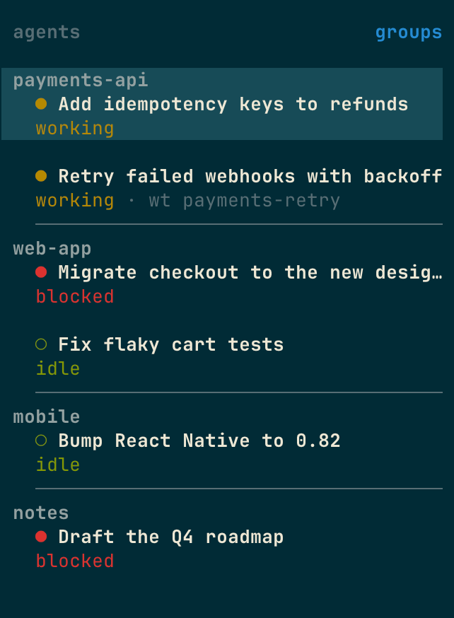

# herdr-groups

A [herdr](https://herdr.dev) plugin that groups the Agents panel by git repo.



- Agents are grouped by the git repo they run in, with the repo name as a header.
- Agents in a git worktree join their main repo's group and get a `wt <folder>` label.
- Agents outside git are grouped by folder name.
- Groups keep herdr's order: a group sits where its first agent's workspace, tab and pane are.
- A line divides one group from the next.

## Requirements

- herdr 0.9.5 or later, on macOS or Linux.
- `curl`, `tar` and `shasum` or `sha256sum` to install. The installer downloads a prebuilt binary, so you don't need Rust.
- `git` on your `PATH` while the plugin runs.

## Install

```sh
herdr plugin install albertocoletta/herdr-groups
```

The plugin adds a **groups** view to the Agents panel and starts with herdr.

### Show the groups

herdr plugins report values, but your sidebar layout decides where they appear. Add the plugin's tokens to `ui.sidebar.agents.rows` in herdr's `config.toml`. This keeps herdr's default rows and adds the three groups rows:

```toml
[ui.sidebar.agents]
rows = [
  ["$header"],
  ["state_icon", "machine", "workspace", "tab"],
  ["agent", "$worktree"],
  ["$divider"],
]
```

| Token       | Value                                                        |
| ----------- | ------------------------------------------------------------ |
| `$header`   | The group name on its first agent; blank on the others.      |
| `$worktree` | `wt <folder>` on agents in a git worktree; absent otherwise. |
| `$divider`  | A line under the last agent of every group but the last.     |

Without these rows the groups view still sorts agents by group, just without headers or dividers.

### Style the tokens

Each token takes the same style table as herdr's built-in tokens: `fg`, `bold`, `dim` and `rules`. See [herdr's sidebar configuration](https://herdr.dev/docs/configuration/) for the details. For example, on a solarized theme:

```toml
[ui.sidebar.agents]
rows = [
  [{ token = "$header", fg = "#93a1a1", bold = true }],
  ["state_icon", { token = "terminal_title_stripped", fg = "#eee8d5", bold = true, dim = false }],
  ["state_text", "$worktree"],
  [{ token = "$divider", fg = "#586e75" }],
]
```

## Configure

Settings live in `config.env` in the plugin's config directory:

```sh
herdr plugin config-dir albertocoletta.groups
```

| Setting         | Default | Meaning                                                        |
| --------------- | ------- | -------------------------------------------------------------- |
| `DIVIDER_WIDTH` | `22`    | Divider length in columns. The default fits herdr's default sidebar width. |

```sh
DIVIDER_WIDTH=36
```

herdr cuts a divider that's wider than the sidebar and adds `…`, so set this to your sidebar width minus 4. The plugin reads the file when it starts, so run **groups: stop** and **groups: start** after a change.

## Use

| Action          | Does                                                                |
| --------------- | ------------------------------------------------------------------- |
| `groups: start` | Starts the plugin, unless you've toggled it off.                    |
| `groups: stop`  | Stops it and clears its tokens and view.                            |
| `groups: toggle`| Turns it off, or back on. Off stays off across herdr restarts.      |

Bind toggle to a key in herdr's `config.toml`:

```toml
[[keys.command]]
key = "alt+g"
type = "plugin_action"
command = "albertocoletta.groups.toggle"
```

## How it works

The plugin starts a background process with herdr and whenever herdr detects an agent. That process polls herdr's session snapshot once a second, works out each agent's repo with `git rev-parse` (once per directory), and reports only the tokens that changed.

It stops when you stop or toggle it, when herdr exits, or when another plugin takes over the Agents view. It keeps its state in herdr's plugin state directory.

## Nix

The flake has a `packages.default` that contains `bin/herdr-groups` and `herdr-plugin.toml`:

```nix
inputs.herdr-groups = {
  url = "github:albertocoletta/herdr-groups";
  inputs.nixpkgs.follows = "nixpkgs";
};
```

## Develop

```sh
nix develop
cargo test
cargo build --release && mkdir -p bin && cp target/release/herdr-groups bin/
herdr plugin link .
```

`herdr plugin link` skips the install step, so `bin/` needs your own build.

To release, run `just release <version>` on an up-to-date `main`. It sets the version, runs the tests, commits, and pushes `main` and the `v<version>` tag. The tag starts the release workflow, which builds the binaries the installer downloads.

## License

MIT. See [LICENSE](LICENSE).
